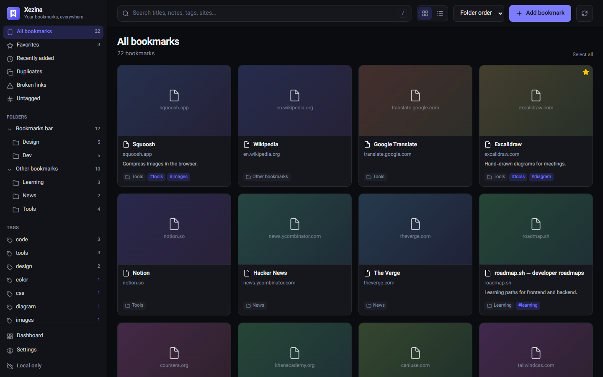
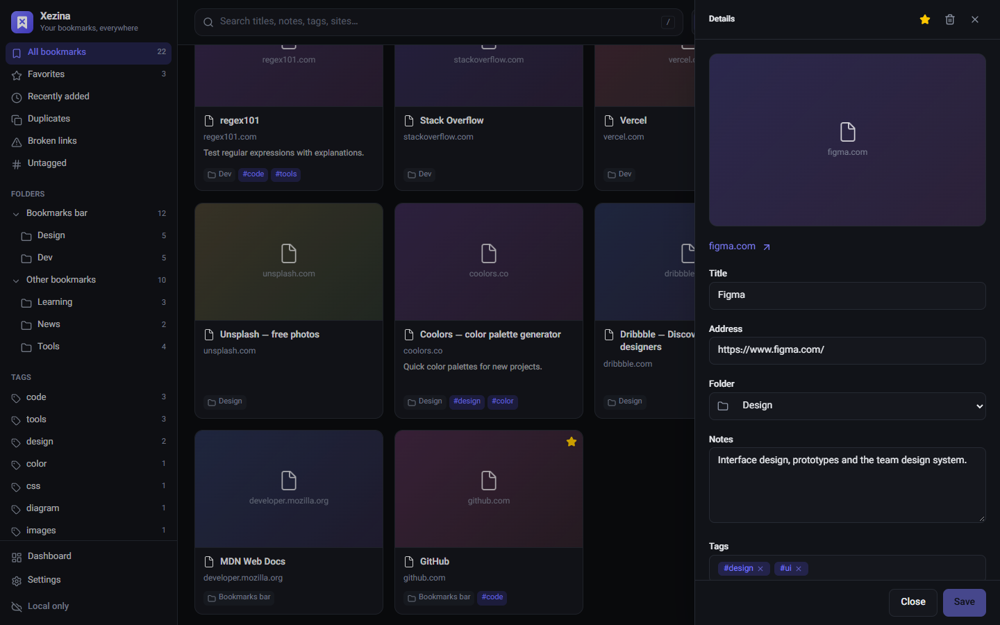
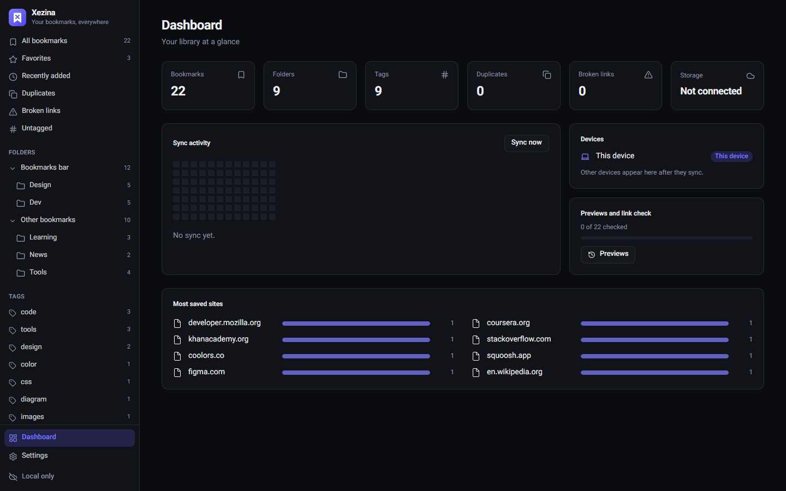

<div dir="rtl">

<div align="center">


# Xezina

**نیشانەکانت لە هەموو وێبگەڕێکدا — ڕێکخراو، گەڕانپێکراو، و پاشەکەوتکراو لەو شوێنەی *خۆت* هەڵیدەبژێریت.**

[](https://github.com/mostafasadeghidev/xezina/releases/latest)
[](https://github.com/mostafasadeghidev/xezina/actions)
[](../../LICENSE)


[English](../../README.md) · [فارسی](README.fa.md) · **کوردی** · [العربية](README.ar.md) · [Deutsch](README.de.md) · [Français](README.fr.md) · [Italiano](README.it.md) · [Português](README.pt.md)

[ماڵپەڕ](https://mostafasadeghidev.github.io/xezina/) · [داگرتن](https://github.com/mostafasadeghidev/xezina/releases/latest) · [تایبەتمەندی](https://mostafasadeghidev.github.io/xezina/privacy.html)



</div>

## بۆچی Xezina؟

سەدان پەڕە پاشەکەوت دەکەیت، دواتر نایاندۆزیتەوە، و هەر وێبگەڕێکیش کۆمەڵێکی جیاوازی هەیە.
Xezina هەردووکیان چارەسەر دەکات:

- **یەک کۆمەڵە نیشانە، لە هەموو شوێنێک.** Chrome، Edge، Brave، Opera، Vivaldi و Firefox وەک یەک دەمێننەوە.
- **کتێبخانەیەک کە بەڕاستی دەتوانیت تێیدا بگەڕێیت.** تێبینی، تاگ، پێشبینین و گەڕانی خێرا لە هەموو شتێکدا.
- **بێ هەژمار، بێ ڕاژەکاری ئێمە.** داتاکانت لە هەور یان ڕاژەکاری خۆتدا دەمێننەوە.

## تایبەتمەندییەکان

| | |
|---|---|
| 🔄 **هاوکاتکردنی ڕاستەقینەی دوولایەنە** | ئەو گۆڕانکارییانەی لە یەک کاتدا لە وێبگەڕی جیاوازدا دەکرێن، خانە بە خانە تێکەڵ دەکرێن. ناوگۆڕین لە وێبگەڕێکدا و گواستنەوە لە یەکێکی تردا، هەردووکیان دەمێننەوە. |
| ☁️ **شوێنی پاشەکەوت بە هەڵبژاردنی خۆت** | Google Drive، Dropbox، OneDrive، WebDAV/Nextcloud، S3/Cloudflare R2، یان کۆگایەکی تایبەتی GitHub. |
| 🔎 **گەڕان لە هەموو شتێک** | ناونیشانەکان، بەستەرەکان، تێبینییەکانت، تاگەکان، ناوی بوخچەکان و وەسفی پەڕەکان. هەڵەی چاپکردن قبووڵ دەکات و شێوە جیاوازەکانی پیتی فارسی/عەرەبی تێدەگات. فلتەرەکانی `#tag` و `site:example.com` بەکاربهێنە، یان لە شریتی ناونیشاندا `bm` و پاشان بۆشایی بنووسە. |
| 📝 **تێبینی و تاگ** | بنووسە بۆچی پەڕەیەکت پاشەکەوت کردووە و تاگی بۆ دابنێ. تێبینی و تاگەکان لەگەڵ نیشانەکەدا هاوکات دەکرێن. |
| 🖼️ **پێشبینین** | وێنەی پێشبینینی خودی ماڵپەڕەکە، یان وێنەیەکی شاشە کە کاتی سەردانی پەڕەیەکی نیشانەکراو دەگیرێت. |
| 🧹 **ئامرازەکانی پاککردنەوە** | نیشانە دووبارەکان و بەستەرە شکاوەکان بدۆزەوە. ژمارەیەکی زۆر نیشانە پێکەوە بگوازەوە، تاگیان بۆ دابنێ یان بیانسڕەوە، یان ڕایانبکێشە سەر بوخچەیەک. |
| 🔐 **شفرەکردنی سەرتاسەری** | ئارەزوومەندانە. داتا پێش بارکردن، لە وێبگەڕەکەتدا بە وشەی نهێنیی خۆت شفرە دەکرێت (AES-256-GCM). |
| 🛟 **تۆڕی سەلامەتی** | یەدەگی خۆکار پێش هەموو هاوکاتکردنێک، گەڕاندنەوە بە یەک کرتە، و داوای پشتڕاستکردنەوە پێش هەر هاوکاتکردنێک کە زۆر نیشانە بسڕێتەوە. |
| 🌍 **٨ زمان** | English، فارسی، کوردی (سۆرانی)، العربية، Deutsch، Français، Italiano، Português — لەگەڵ پشتگیریی تەواوی نووسینی ڕاستەوچەپ. |

<div align="center">


</div>

## هەڵبژاردنەکانی پاشەکەوتکردن

| شوێنی پاشەکەوت | گونجاوە بۆ | پێویستت بە چییە |
|---|---|---|
| **Google Drive** | هەمووان | چوونەژوورەوە — فایلەکان دەچنە بوخچەیەکی شاراوەی تایبەت بە بەرنامەکە |
| **Dropbox** | هەمووان | چوونەژوورەوە — فایلەکان دەچنە `Apps/Xezina` |
| **OneDrive** | هەمووان | چوونەژوورەوە — فایلەکان دەچنە `Apps/Xezina` |
| **WebDAV** | Nextcloud، ownCloud، Synology، QNAP، ڕاژەکاری خۆت | ناونیشان، ناوی بەکارهێنەر، وشەی نهێنیی بەرنامە (app password) |
| **گونجاو لەگەڵ S3** | Cloudflare R2، ArvanCloud، AWS S3، MinIO، Backblaze B2 | endpoint، bucket، کلیلەکانی دەستگەیشتن |
| **GitHub** | گەشەپێدەران؛ مێژووی تەواوی وەشانەکان | تۆکنێکی fine-grained (Xezina خۆی کۆگایەکی تایبەت دروست دەکات) |

## دامەزراندن

1. نوێترین فایلی zip لە **[Releases](https://github.com/mostafasadeghidev/xezina/releases/latest)** دابگرە.
2. **Chrome، Edge، Brave، Opera، Vivaldi:** `xezina-*-chrome.zip` بکەرەوە ← `chrome://extensions` بکەرەوە
   (لە Edge: `edge://extensions`) ← **Developer mode** (دۆخی گەشەپێدەر) چالاک بکە ← **Load unpacked** ← بوخچە کراوەکە هەڵبژێرە.
3. **Firefox:** `xezina-*-firefox.zip` بەکاربهێنە. وەشانێکی واژۆکراو لە addons.mozilla.org بڵاو دەکرێتەوە.

بوخچە کراوەکە لە شوێنی خۆیدا بهێڵەوە: وێبگەڕەکە پێوەکراوەکە لەوێوە بار دەکات.

## دەستپێکی خێرا

1. Xezina بە <kbd>Alt</kbd>+<kbd>Shift</kbd>+<kbd>B</kbd> بکەرەوە، یان کرتە لە ئایکۆنەکەی شریتی ئامراز بکە ← دوگمەی تۆڕ.
2. بڕۆ بۆ **ڕێکخستنەکان ← هاوکاتکردن**، شوێنێکی پاشەکەوت هەڵبژێرە و پەیوەندی بکە.
3. Xezina لە وێبگەڕەکانی ترتدا دابمەزرێنە و بە **هەمان شوێنی پاشەکەوت** بیانبەستەوە.
   ئەگەر شفرەکردن بەکاردەهێنیت، هەمان وشەی نهێنی بنووسە.
4. تەواو. نیشانەکانت لە شریت و لیستی نیشانەکانی خودی هەر وێبگەڕێکدا دەردەکەون. بەڕێوەبەری Xezina
   تەنها کاتێک بکەرەوە کە دەتەوێت بگەڕێیت، تێبینی بنووسیت یان ڕێکی بخەیت.

> [!TIP]
> لەو ئامێرانەی Xezina هاوکاتکردنیان تێدا دەکات، هاوکاتکردنی نیشانەی خودی وێبگەڕەکە بکوژێنەرەوە (Chrome Sync بۆ نیشانەکان،
> هاوکاتکردنی Favorites لە Edge)، بۆ ئەوەی دوو سیستەم دەستکاری هەمان نیشانەکان نەکەن.

> [!NOTE]
> یەکەم جار کە وێبگەڕێک پەیوەندی دەکات، ئەو نیشانانەی لەگەڵ ئەوانی تردا هاوبەشن (هەمان بوخچە،
> هەمان بەستەر) بەیەکەوە دەگونجێنرێن نەک دووبارە ببنەوە. بۆ ئەوەی وێبگەڕێک **ڕێک** وەک کۆپیی هەور
> بێت، یەک جار **ڕێکخستنەکان ← هاوکاتکردن ← ئەم وێبگەڕە وەک هەور لێبکە** بەکاربهێنە. پێشتر یەدەگێک دروست دەکرێت.

## پرسیارە باوەکان

<details>
<summary><b>ئایا Xezina نیشانەکان یان گەشتی ئینتەرنێتم دەبینێت؟</b></summary>

نەخێر. Xezina هیچ ڕاژەکارێکی نییە. هەموو شتێک ڕاستەوخۆ لە وێبگەڕەکەتەوە دەچێت بۆ ئەو شوێنی پاشەکەوتەی
هەڵتبژاردووە. پەڕەکان تەنها ئەگەر ڕێگەت بە پێشبینین دابێت دەخوێنرێنەوە، و تەنها ئەو پەڕانەی نیشانەت کردوون.
</details>

<details>
<summary><b>ئەگەر هەمان نیشانە لە دوو وێبگەڕدا دەستکاری بکەم چی دەبێت؟</b></summary>

هەر خانەیەک (ناونیشان، بەستەر، بوخچە، شوێن، تێبینی، تاگەکان) بە جیا تێکەڵ دەکرێت، و نوێترین گۆڕانکاریی
ئەو خانەیە سەردەکەوێت. گۆڕانکارییە جیاوازەکانی هەمان نیشانە هەموویان دەپارێزرێن.
</details>

<details>
<summary><b>ئەگەر هاوکاتکردنێک بە هەڵەدا بچێت چی؟</b></summary>

Xezina پێش هەموو هاوکاتکردنێک کە نیشانەکانت بگۆڕێت، یەدەگ دەگرێت. هەر یەکێک لە دوایین ٣٠ یەدەگ
لە **ڕێکخستنەکان ← یەدەگ و داتا** بگەڕێنەوە. هاوکاتکردنێک کە زۆر نیشانە بسڕێتەوە، چاوەڕێی
پشتڕاستکردنەوەی تۆ دەکات.
</details>

<details>
<summary><b>چوونەژوورەوەی Google Drive / Dropbox / OneDrive دەڵێت بەرنامەکە ڕێکنەخراوە.</b></summary>

ئەم خزمەتگوزارییانە پێویستیان بە یەک جار تۆمارکردنی بەرنامە هەیە لەلایەن ئەو کەسەی وەشانەکە بڵاو دەکاتەوە. سەیری
[docs/oauth-setup.md](../oauth-setup.md) بکە. WebDAV، S3 و GitHub بەبێ ئەوە کار دەکەن.
</details>

<details>
<summary><b>دەتوانم نیشانەکانم هەناردە بکەم؟</b></summary>

بەڵێ. لە **ڕێکخستنەکان ← یەدەگ و داتا** دەتوانیت بۆ HTMLی ستاندارد (کە هەموو وێبگەڕێک هاوردەی دەکات) یان JSON
(لەگەڵ تێبینی و تاگەکان) هەناردە بکەیت، و فایلی HTML هاوردە بکەیت.
</details>

## هاوکاتکردن چۆن کار دەکات

هەر نیشانەیەک تۆمارێکە کە هەر خانەیەکی مۆری کاتیی hybrid logical clockـی پێیە. هەر ئامێرێک
کۆپیی تەواوی تێکەڵکراوی خۆی وەک یەک فایل (`devices/<id>.xz`) بار دەکات و فایلی ئامێرەکانی تر
دەخوێنێتەوە. تێکەڵکردن نوێترین بەهای هەر خانەیەک وەردەگرێت، بۆیە ئەنجامەکە هەمان شتە بە هەر ڕیزبەندییەک
فایلەکان بگەن (CRDTێکی پشتبەستوو بە دۆخ). لەبەر ئەوەی هەر ئامێرێک تەنها فایلی خۆی دەنووسێت، هەر شوێنێکی
ئاسایی پاشەکەوتی فایل کار دەکات، و هەرگیز دوو ئامێر کاری یەکتر ناسڕنەوە. بڕگە سڕاوەکان وەک tombstone
دەهێڵدرێنەوە؛ بوخچەیەک کە لە ئامێرێکدا بسڕدرێتەوە بەڵام لە ئامێرێکی تردا نیشانەیەکی نوێی بۆ زیاد بکرێت، لەگەڵ
ئەو نیشانەیەدا دەگەڕێتەوە. ڕیزبەندی لەناو بوخچەکاندا بە fractional indexing دیاری دەکرێت.

## گەشەپێدان

```bash
pnpm install
pnpm dev                 # Chrome with live reload  (pnpm dev:firefox for Firefox)
pnpm test                # unit tests + randomized multi-browser sync simulations
pnpm build && node scripts/e2e.mjs        # two real Edge profiles syncing over WebDAV
pnpm build && node scripts/screenshots.mjs  # regenerate docs/screenshots
pnpm zip && pnpm zip:firefox
```

| بوخچە | ناوەڕۆک |
|---|---|
| `src/core` | مۆدێلی داتا، تێکەڵکردنی CRDT، ڕیزبەندی، گەڕان |
| `src/sync` | خوێندنەوە و جێبەجێکردنی نیشانەکانی وێبگەڕ، گونجاندن لە یەکەم پەیوەندیدا، شفرەکردن |
| `src/storage` | ئەداپتەرێکی بچووک بۆ هەر دابینکەرێکی پاشەکەوت |
| `src/background` | خشتەدانەر، پێشبینینەکان، پشکنەری بەستەر |
| `src/ui` | بەڕێوەبەر، پەنجەرەی popup، وەرگێڕانەکان (`src/ui/i18n`) |
| `docs` | ماڵپەڕ (GitHub Pages)، وێنەی شاشە، README وەرگێڕدراوەکان |

**بەرنامەکانی چوونەژوورەوە:** Google Drive، Dropbox، OneDrive و «Sign in with GitHub» پێویستیان بە OAuth client id هەیە،
کە کاتی build لە `.env` دەخوێنرێنەوە (سەیری `.env.example` بکە) یان بەکارهێنەران خۆیان لە
**ڕێکخستنەکان ← پێشکەوتوو** دەینووسن. ڕێنمایی هەنگاو بە هەنگاو: [docs/oauth-setup.md](../oauth-setup.md).

**وەرگێڕانەکان:** دەقەکانی ڕووکار لە `src/ui/i18n/<lang>.ts` دان، دەقەکانی ماڵپەڕ لە
`docs/i18n/<lang>.js`. ڕاستکردنەوەی ئاخێوەرانی ڕەسەن زۆر بەخێرهاتنە.

## مۆڵەت

[MIT](../../LICENSE) © Mostafa Sadeghi

</div>
